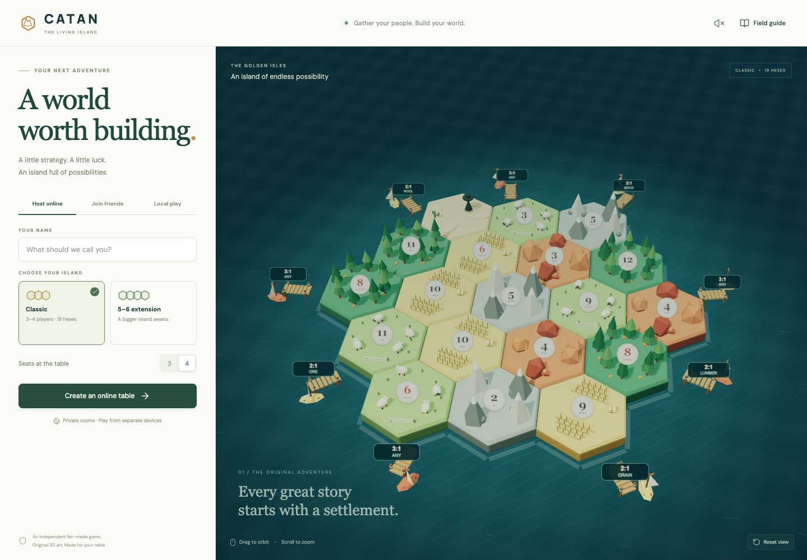

# CATAN · The Living Island

A playable 3D island for a table of friends: orbit a miniature landscape, build settlements and roads, negotiate trades, and race to ten victory points. The application includes an authoritative multiplayer server for private online rooms and local pass-and-play.



[View the in-game table](docs/images/gameplay.png) · [Six-player extension](docs/images/extension.png) · [Mobile lobby](docs/images/mobile.png).

| Mode          | Players | Terrain hexes | Resource supply     | Development deck |
| ------------- | ------- | ------------- | ------------------- | ---------------- |
| Classic       | 3–4     | 19            | 19 of each resource | 25 cards         |
| 5–6 extension | 5–6     | 30            | 24 of each resource | 34 cards         |

**Internet play requires running this project on a public Node/Docker host.** The included server provides online multiplayer, but creating a repository or starting `localhost` does not publish it to the internet. Deployment files and instructions are included below; no hosting account or paid service is created automatically.

## Start on your computer

Install Node.js 22.12 or newer and npm. On macOS, double-click **Play Catan.command** to build, start the server, and open the game in your browser. Keep its Terminal window open while playing.

Or, from the Desktop repository:

```sh
cd ~/Desktop/catan-3d
npm ci
npm run dev
```

Open [localhost:5173](http://localhost:5173). The development command starts Vite and the multiplayer server together; Vite forwards `/socket.io` to the server on port 3001. Keep the terminal running. Choose **Local play** for one screen, or use separate browser profiles/devices for online seats.

To run the built application through one server:

```sh
npm run build
npm start
```

Open [localhost:3001](http://localhost:3001). The server serves `dist/` and Socket.IO from the same origin. Build before starting production, and restart the server after rebuilding. `npm run preview` previews frontend files only and is not the multiplayer production server.

## Play with friends

1. Open the same public application URL on each player's device.
2. The host selects **Host online**, chooses Classic or the extension, chooses the number of seats, and enters a name.
3. Click the room code to copy an invitation link. Friends can follow the link or choose **Join friends** and enter the six-character code.
4. Every seat must be filled and connected before the host can start.
5. Place settlements and adjoining roads in the guided setup. The interface highlights legal positions and walks each player through their turn.

The room code admits new players to an unstarted lobby. A separate, private reconnect token saves your seat in your browser. After a refresh, choose **Rejoin online table**. Network interruptions reconnect automatically while the application remains open. Using the same saved seat in another tab transfers control to that tab.

Each player should use their own device or browser profile. Clearing site data, changing browsers, or losing the reconnect token loses access to that seat. Online seats do not have accounts, passwords, email recovery, bots, spectators, seat replacement, or host kick controls. A disconnected player's seat remains reserved; play waits when their action is required. Rooms with no activity for 72 hours can expire; active connected rooms are not removed by the running server's cleanup task.

Local play saves automatically in browser storage and hides the next player's hand behind a pass-screen prompt. It is intended for people sharing one device: all local state exists in that browser and is not protected from someone inspecting developer tools or browser storage.

## Shared rankings

Choose **Rankings** in the game header, or open `/#rankings`. Everyone can read the leaderboard and game chronicle. Players rank by **total victory points** across recorded games; equal totals share a rank.

On localhost, choose **Set up owner access** and create your private password. The owner can add or rename players and record, edit, or delete games with a date, two to six players, notes, and each player's VP breakdown. Totals calculate from settlements, cities, victory point cards, Longest Road, Largest Army, and optional other VP. Records are manual, so tabletop games can be included too.

For a public deployment, use **Cloud Firestore**, set the private `RANKINGS_ADMIN_PASSWORD` environment secret, and serve the app over HTTPS. The server authenticates with Firebase Admin; browser visitors do not receive database credentials. The configured project is `inventory-management-6626b`, with ledger metadata at `catan/rankings` and player/game subcollections below it. Existing JSON records can be imported explicitly. See [Firestore setup and migration](docs/FIRESTORE.md) and [owner setup, scoring, and recovery](docs/RANKINGS.md).

Without Firestore configuration, local development retains file storage. `RANKINGS_STORAGE=firestore` selects the database explicitly and never falls back to files on a connection or credential error. Live online rooms still use file storage and need a persistent disk to survive deployments.

## Board controls

| Action                                 | Control                                             |
| -------------------------------------- | --------------------------------------------------- |
| Orbit the island                       | Drag the board                                      |
| Zoom                                   | Mouse wheel or trackpad scroll                      |
| Select road / settlement / city        | Build buttons or `1` / `2` / `3`                    |
| Place a piece                          | Click a highlighted legal position                  |
| Cancel a build choice                  | `Esc`                                               |
| Place without precision clicking       | Expand **Keyboard placement** and choose a location |
| Move the robber without clicking a hex | Expand **Keyboard robber movement**                 |
| Restore the view                       | Board reset-view button                             |
| See rules                              | **Field guide**                                     |

Dice sound is optional. The landscape, trees, fields, rocks, ports, ocean, and medieval building pieces are generated with Three.js. Sculpted ground uses original high-detail material textures; the interface uses parchment, oak, brass, and period-inspired serif typography. All game art is included locally. See [art materials and exact generation prompts](docs/ART.md). Reduced-motion preferences freeze ambient animation and redraw only when the board or camera changes; inactive tabs pause rendering.

## Rules implemented

- Two settlements and two roads per player in forward-then-reverse setup order; starting resources come from the second settlement.
- Dice production for every player, settlements producing one and cities two, finite bank supplies, and robber blocking.
- Connected road construction, settlement distance restrictions, city upgrades, and piece limits of 15 roads, 5 settlements, and 4 cities per player.
- Bank trades at 4:1, general harbors at 3:1, and matching resource harbors at 2:1.
- Online player trade offers require the recipient to accept. Offers expire after 90 seconds or when the active player takes another game action. Resources move only after server validation and acceptance.
- A seven triggers required discards, robber movement, and random theft from an eligible neighboring opponent. Knights move the robber without triggering discards.
- Knight, Road Building, Year of Plenty, Monopoly, and hidden victory-point development cards; purchase-turn restrictions and one played action card per turn.
- Longest Road, including branches, loops, ties, and opponent settlements breaking a route; Largest Army; automatic victory checks on the active player's turn.
- Randomized islands with separated 6/8 tokens, port locations, visible production probabilities, and a turn history.

The extension uses the **paired-player sequence described in the 2025 rules**. After the primary player's production and action phases, the player three seats clockwise receives an action phase. That player can build, use development cards, and trade with the bank, but cannot trade with players. Either active player can win during their own part of the turn. The primary player then advances one seat. The older special building phase is not used. See the [official 2025 extension rulebook](https://www.catan.com/sites/default/files/2025-03/CN3082%20CATAN%20%E2%80%93%205-6%20Rulebook%202025%20reduced.pdf) and [official rules collection](https://www.catan.com/understand-catan/game-rules).

This implementation uses randomized variable boards and starts with the first listed player/host. It does not roll to select the starting player or reproduce the printed beginner fixed layouts. Other expansions such as Seafarers and Cities & Knights are not included.

## Deploy on Render

The included `Dockerfile` builds the frontend and runs one Node process. `render.yaml` describes a web service with `/api/health` as its health check. The default Blueprint selects a **free demonstration service without persistent storage**. Review the account's current service options before choosing a plan. The fields follow Render's [Blueprint reference](https://render.com/docs/blueprint-spec).

1. Push this repository to a Git repository you control.
2. In Render, create a **Blueprint** from that repository, or create a **Web Service** using the Docker runtime and this repository's `Dockerfile`.
3. Supply the requested `FIREBASE_SERVICE_ACCOUNT_JSON` and `RANKINGS_ADMIN_PASSWORD` secrets. The Blueprint uses the existing Firebase project for rankings; it does not create a new database or billing plan. See [Firestore setup](docs/FIRESTORE.md).
4. Deploy the repository root. The Dockerfile supplies its own build and start commands; no additional Docker command is needed.
5. Once available, open the service's public HTTPS URL and verify that `/api/health` returns `{"ok":true,...}` and `/api/rankings` loads the expected records.
6. Create a room and join from a separate browser/device before sharing the URL with your whole group.

Render builds the image from the repository and starts the Dockerfile's command. See [Docker on Render](https://render.com/docs/docker) and [web service setup](https://render.com/docs/web-services).

**For games that must survive host restarts and redeploys, configure persistence.** Render's default filesystem is ephemeral, and persistent disks require an eligible paid service. Select that plan yourself, attach a disk mounted at `/app/server/data`, and keep `CATAN_DATA_DIR=/app/server/data`. The commented `disk` block in `render.yaml` provides the same setup. Only data inside the mounted directory survives. A disk also affects deployment behavior; review [Render's disk documentation](https://render.com/docs/disks) before enabling one.

Use the HTTPS application URL; Socket.IO then establishes secure WebSocket connections automatically. The proxy must support the `/socket.io/` route, HTTP polling, and WebSocket upgrades. Render documents public connections using `wss` in its [WebSocket guide](https://render.com/docs/websocket).

If a proxy changes the incoming Host header, set `ALLOWED_ORIGINS` to the exact public origin, for example `https://your-service.onrender.com`. Include a custom domain as an additional comma-separated entry when applicable. Do not use a wildcard or add paths/trailing slashes.

## Other Node hosts and Docker

A long-running Node host can use:

```sh
npm ci
npm run build
NODE_ENV=production npm start
```

Expose the assigned `PORT`, terminate HTTPS at the host/reverse proxy, forward WebSocket upgrades, and provide a writable persistent directory via `CATAN_DATA_DIR`. Deploy **one instance**. Rooms are held in process memory and saved to a local file; horizontal scaling, multiple Node workers, and serverless functions need a shared state/persistence design that this project does not implement.

To run the provided image locally with a named data volume:

```sh
docker build -t catan-3d .
docker volume create catan-room-data
docker run --rm --name catan-3d -p 3001:3001 \
  -v catan-room-data:/app/server/data catan-3d
```

The container runs as the `node` user. Bind-mounted directories must be writable by that user (UID 1000). Check logs for persistence errors after attaching a host-managed disk. The health check confirms the HTTP server is alive; it does not confirm writable storage or a complete game session.

## Configuration and saved games

| Variable                  | Default                    | Purpose                                                                                      |
| ------------------------- | -------------------------- | -------------------------------------------------------------------------------------------- |
| `PORT`                    | `3001`                     | HTTP and Socket.IO listening port; binds on all interfaces                                   |
| `NODE_ENV`                | Unset                      | Use `production` on public deployments                                                       |
| `CATAN_DATA_DIR`          | `<repository>/server/data` | Writable directory containing room saves, rankings, and local owner credentials              |
| `ALLOWED_ORIGINS`         | Empty                      | Extra exact browser origins accepted by the socket server; same-origin requests already work |
| `RANKINGS_ADMIN_PASSWORD` | Unset                      | Private owner password for rankings; at least ten characters; configure as a hosting secret  |

`RANKINGS_STORAGE=firestore`, `FIREBASE_PROJECT_ID`, `FIRESTORE_RANKINGS_DOCUMENT`, and a server credential source configure cloud rankings. See [all Firebase settings](docs/FIRESTORE.md). `.env.example` documents these values. `npm start` and `npm run dev` load an ignored `.env` file when present; hosting or shell environment variables take precedence. To start the server directly after copying the example to `.env`:

```sh
node --env-file=.env --import tsx server/index.ts
```

Room state is saved after lobby changes and successful game actions using an atomic file replacement. Reconnect tokens are stored as hashes on the server. Trade offers are transient and disappear on restart. Keep `server/data/`, real environment files, and backups out of Git. Back up the data directory when no game actions are being written; stop the server before manually restoring a backup. The save file contains private game state and should not be served as a static asset.

## Multiplayer privacy and operational limits

The server owns the game state and validates each actor and action. Opponents receive public hand sizes and visible scores; their resource breakdowns, development-card identities, future deck order, seed, and RNG are removed from snapshots during play. Development cards are revealed after the game ends so final scores can be verified. Development decks and online random actions use server-side cryptographic randomness independent of the public board. Requests and room creation are rate limited, and trade acceptance cannot be replayed.

Seat tokens are bearer credentials stored in browser local storage. Share room invitation links, never tokens or storage exports. Use HTTPS and keep the hosting account and persistent data access restricted. Browser-origin checks complement seat authentication; they do not authenticate non-browser clients. The host operator can read server state, and this is a private-friends application rather than an audited competitive platform or account service.

## Verification

```sh
npm test
npm run test:server
npm run test:rankings
npm run build
npx playwright install chromium
npm run test:e2e
```

The browser suite checks local save/resume, four- and six-player online room setup, turn ownership, paired turns, reconnecting, and the mobile interface. The engine suite includes full matches through a 10-point win in both modes.

The rankings suite builds the app, checks the owner API, and runs isolated browser tests for public reading, recording/editing/deleting games, renaming players, six-player records, mobile layout, session expiry, and concurrent edits. It uses temporary storage and does not change your real ledger.

`npm run test:firestore` verifies cloud storage behavior against a local Firestore emulator, including atomic conflicts, restart persistence, and safe import. It requires the emulator described in [Firestore verification](docs/FIRESTORE.md#emulator-verification) and refuses to use the real Firebase project.

The engine suite checks board generation and rule behavior. The server integration runner starts a temporary real Socket.IO server and checks standard/extension rooms, setup, hidden hands, turn ownership, consent-only trades, origin rejection, hashed reconnect tokens, single-seat control, and recovery after a process restart. It uses temporary storage and removes it afterward. A sandbox must permit listening on a local TCP port to run this test.

## Troubleshooting

| Symptom                                | Check                                                                                                                                       |
| -------------------------------------- | ------------------------------------------------------------------------------------------------------------------------------------------- |
| Online buttons report no connection    | Run `npm run dev` or the production Node server; frontend-only preview cannot host rooms. Inspect `/api/health`.                            |
| Friends cannot use your invite         | A `localhost` address is only local to each person's computer. Use the deployed public HTTPS URL.                                           |
| Socket connection fails behind a proxy | Forward `/socket.io/` and WebSocket upgrades; set the exact public `ALLOWED_ORIGINS` value if the proxy rewrites Host.                      |
| Game disappears after host redeploy    | Attach persistent storage and point `CATAN_DATA_DIR` at its writable mount path. Check server logs for save errors.                         |
| Saved seat cannot reconnect            | Use the original browser/profile and origin. Expired rooms, missing tokens, or lost server data cannot be recovered through accounts.       |
| Game waits for an absent player        | Reserved seats are not replaced by AI. That player must reconnect to take their turn or discard.                                            |
| Empty/slow 3D board                    | Use a modern WebGL-capable browser with hardware acceleration; update graphics drivers/browser, close GPU-heavy tabs, and restore the view. |
| Clipboard copy fails                   | Clipboard access may require HTTPS or localhost. Share the displayed room code and application URL manually.                                |
| Port already in use                    | Stop the other server or choose a different `PORT`; update the Vite socket proxy if changing its development backend port.                  |

## Project layout

```text
src/App.tsx                 Lobby, turns, hands, dialogs, local save/rejoin
src/components/Board3D.tsx   Island rendering, lighting, water, camera, picking
src/components/TerrainScenery.ts  Sculpted terrain, plants, animals, medieval buildings
src/medieval.css             Renaissance materials, typography, responsive theme
public/textures/            Original terrain atlas, parchment, and oak materials
src/game/board.ts           Hex topology, balanced token placement, harbors
src/game/engine.ts          Pure authoritative rules and state transitions
src/game/types.ts           Shared game types
src/network.ts              Typed Socket.IO client and saved seat handling
src/components/RankingsPage.tsx  Public leaderboard, game records, and owner editing
src/rankings/               VP model, standings, validation, and API client
src/rankings.css            Medieval rankings layout and responsive dialogs
server/index.ts             Rooms, authentication, privacy, persistence, hosting
server/rankings.ts          Persistent ledger, owner authentication, and rankings API
server/rankings-firestore.ts  Atomic cloud records and revision conflict checks
server/firebase.ts          Server-only Firebase credentials and database configuration
server/rankings-import.ts   Explicit, non-overwriting import of existing JSON records
server/smoke.ts             Real multiplayer integration tests
server/rankings.smoke.ts    Isolated rankings HTTP integration tests
Dockerfile                 Production image
render.yaml                Optional deployment Blueprint
```

Independent fan project, not affiliated with or endorsed by the CATAN rights holders. CATAN and related names belong to their respective owners. The landscape and interface use original procedural geometry, code assets, and generated material textures, not extracted official artwork. Consult the official rulebooks for the tabletop game.
